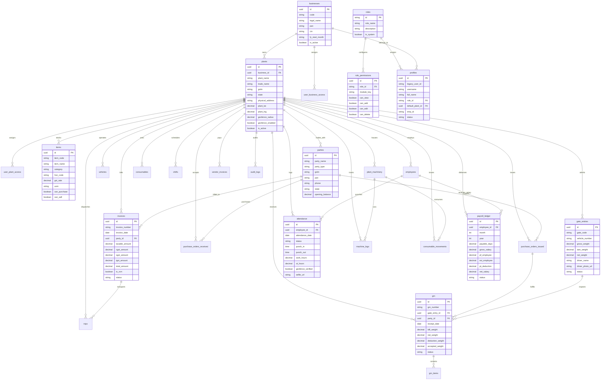

# EcoManage ERP (Wastech App) - Master PRD, System Architecture & Engineering Blueprint

> **Document Type:** Product Requirement Document (PRD) cum Technical Architecture cum AI Master Prompt  
> **Target System:** EcoManage ERP (Enterprise Waste Recycling & Processing Plant Management System)  
> **Version:** 3.0 Enterprise Edition (Live Supabase & RBAC Multi-Plant Architecture)  
> **Status:** Final Master Specification  

---

## 1. Executive Summary & Product Vision

### 1.1 Purpose
**EcoManage ERP** is an end-to-end, multi-tenant, multi-plant Enterprise Resource Planning (ERP) platform purpose-built for the waste management, recycling, material recovery, and scrap processing industry. 

Unlike generic manufacturing ERPs, EcoManage is engineered specifically to address the unique complexities of recycling facilities:
- **Variable material inputs:** Non-standardized scrap, moisture/dirt deductions, contamination percentages.
- **Two-stage weighbridge logistics:** Gross weight and Tare weight capture with camera proof and E-Way bill verification.
- **Strict multi-plant isolation:** Multi-business and multi-facility operations under distinct GSTINs, State Pollution Control Board (SPCB) consents, and Extended Producer Responsibility (EPR) registrations.
- **Zero-trust Role-Based Access Control (RBAC):** Strict database-enforced row-level security (RLS) and granular functional permissions (`view`, `add`, `edit`, `delete`) per operational module.
- **Indian Statutory & Financial Compliance:** GST (CGST/SGST/IGST), Reverse Charge Mechanism (RCM for scrap procurement from unregistered dealers), HSN code mapping, E-Way Bill generation, EPF/ESIC statutory payroll deductions, and Professional Tax (PT).

### 1.2 Target Personas
1. **Plant Head / Super Admin:** Monitors cross-plant KPIs, financial margins, total inward/outward tonnage, and audit trails.
2. **Weighbridge & Security Officer:** Manages vehicle gate entry, driver verification, gross/tare weighments, and gate passes.
3. **Store & Inventory Manager:** Inspects inward scrap via GRN (Goods Receipt Note), manages deductions, tracks consumables/spare parts, and handles scrap sorting.
4. **Plant Operations / Maintenance Engineer:** Records machine operating hours, diesel/power consumption, breakdown maintenance, and machine uptime.
5. **Sales & Procurement Officer:** Issues POs to scrap vendors, manages customer sales orders, tracks delivery timelines, and monitors fulfillment rates.
6. **Accountant & Billing Executive:** Generates GST-compliant tax invoices, records vendor bills with 3-way matching (PO vs. GRN vs. Invoice), monitors payments, and reviews tax ledgers.
7. **HR & Payroll Manager:** Maintains employee master data, tracks biometric/geofenced selfie attendance, configures shift policies, and computes monthly payroll.

---

## 2. System Architecture & High-Level Design

### 2.1 Technology Stack
- **Frontend Presentation Layer:** Modern Vanilla HTML5, Vanilla JavaScript (ES2022+), TailwindCSS utility-first styling, FontAwesome 6 Pro icon system, and MapLibre GL for GPS fleet tracking.
- **State Management & Data Layer:** Reactive in-memory state engine (`state.data`, `state.liveMasters`, `state.currentPermissions`) synchronized with backend cloud database via `supabase-client.js` and PostgREST APIs.
- **Backend & Database Layer:** PostgreSQL 15+ hosted on Supabase Cloud, leveraging:
  - Row Level Security (RLS) policies on every canonical table.
  - Granular RBAC tables (`roles`, `role_permissions`, `user_business_access`, `user_plant_access`).
  - Foreign key constraints, cascade triggers, and transactional integrity.
- **Security & Identity:** Supabase GoTrue Auth (JWT Bearer tokens), encrypted session persistence, password reset workflows, and fail-closed security guards.

---

## 3. Complete Business Logic by Module (34 Modules + 14 Reports)

### Module Category 1: System & Access Control
#### 1. Real Authentication & Session Hydration (`auth`)
- **Login Flow:** User authenticates with email and password against Supabase Auth.
- **Hydration Gate:** 
  1. Validates JWT session.
  2. Queries `profiles` table to fetch user metadata and assigned `role_id`.
  3. Queries `user_business_access` and `user_plant_access` to establish multi-plant scope.
  4. Fetches role permissions (`can_view`, `can_add`, `can_edit`, `can_delete`) across all 34 modules.
  5. If user has no active plant or business mapping, session is immediately locked with an explicit authorization denial.
- **Auto Re-Hydration:** Listens to `onAuthStateChange` (`SIGNED_IN`, `SIGNED_OUT`, `TOKEN_REFRESHED`).

#### 2. Multi-Plant & Business Context Switcher (`company-select`)
- Strictly filters selectable plants to those authorized in `user_plant_access`.
- Changing plant dynamically switches:
  - Default GSTIN, plant address, bank details, and SPCB/EPR credentials.
  - Filter criteria for all subsequent data grids, forms, and analytical reports.
  - Active Financial Year (FY) parameters.

#### 3. Financial Year & Working Period Engine (`fy-badge`)
- Indian FY calendar (e.g., April 1 to March 31).
- Allows users to freeze or navigate back to historical accounting periods for auditing or back-dated entry creation without changing system real-time clock.

#### 4. Audit Log Center (`auditLogs`)
- Every record modification (`CREATE`, `UPDATE`, `DELETE`) triggers an immutable audit log entry.
- Stores: `timestamp`, `user_id`, `user_email`, `module_key`, `record_id`, `action`, `details`, and a complete JSON snapshot of `before_state` and `after_state`.
- Built-in visual record snapshot inspector allowing administrators to inspect full historical state diffs.

#### 5. Roles & Permissions Master (`rolesMaster`)
- Allows defining custom organizational roles (e.g., `Weighbridge Operator`, `Store Keeper`, `Accountant`).
- Grid of 34 modules $\times$ 4 granular privileges (`can_view`, `can_add`, `can_edit`, `can_delete`).
- System-locked roles (e.g., `ROLE-ADMIN`) cannot be deleted or stripped of master rights.

#### 6. User Management Master (`usersMaster`)
- Maps Supabase auth accounts with employee records (`profiles.emp_id`).
- Controls assignment of Role, Default Plant, and Active/Inactive operational status.

---

### Module Category 2: Core Catalogs & Masters
#### 7. Unit Master (`unitMaster`)
- Canonical units of measurement (UoM): MT (Metric Ton), KG (Kilogram), NOS (Pieces/Units), LTR (Litre), BUNDLE, MTR.
- Ensures cross-module unit consistency across procurement, stock, and billing.

#### 8. PO Type Master (`poTypeMaster`)
- Classifies orders into: `Regular Purchase`, `Open / Blanket Order`, `Job Work / Processing`, and `Rate Contract`.

#### 9. Item Master (`itemMaster`)
- Master catalog of all recyclable materials, finished recycled products, and secondary scrap:
  - *Attributes:* Item Code, Item Name, Category (Plastic Scrap, Cardboard/Paper, Metal, E-Waste, Glass, RDF), HSN/SAC Code, GST Rate (0%, 5%, 12%, 18%, 28%), Default Buying Rate, Default Selling Rate, Primary UoM.
  - *Flags:* `can_purchase` (raw material), `can_sell` (finished recycled good).

#### 10. Party Master (`partiesMaster`)
- Unified directory of commercial partners:
  - *Party Types:* `Vendor` (Scrap dealer, Kabadiwala, Municipal contractor), `Customer` (Recycling factory, converter, end-buyer), `Transporter` (Logistics fleet provider), `Job Worker`.
  - *Statutory Information:* Legal Name, Trade Name, GSTIN, PAN, State Code, Full Address, Contact Person, Phone, Email.
  - *Financial Parameters:* Credit Limit, Credit Days, Opening Balance (Debit/Credit), Bank Account details.

#### 11. Fleet / Vehicle Master (`vehicleMaster`)
- Manages dedicated and third-party transport vehicles:
  - Vehicle Registration Number, Vehicle Type (10-Tyre Truck, 6-Tyre Truck, Tractor, Pickup, Tipper), Transporter Name, Tare Weight (Empty vehicle baseline), Driver Name, Driver Phone, RC Expiry, Fitness Expiry, Insurance Expiry, Pollution (PUC) Expiry.

#### 12. Plant Machinery Master (`machineryMaster`)
- Capital assets and processing equipment:
  - Machine Code, Machine Name, Machinery Type (Hydraulic Baler, High-Speed Shredder, Granulator, Washing Line, Extruder, Conveyor Belt, Forklift, Diesel Generator, Electronic Weighbridge).
  - Serial Number, Make/Model, Power Rating (HP/kW), Fuel Type (Electric, Diesel), Standard Fuel Consumption Rate (Litres/Hour), Maintenance Interval (Hours).

#### 13. Consumables & Spares Master (`consumablesMaster`)
- Operating supplies required for recycling machinery:
  - Item Name (Hydraulic Oil ISO 68, Shredder Blades, Baling Wire, Bearings, Lubricant Grease, Packaging Bags, Safety PPE).
  - Part Number, Category, Current Stock, Unit of Measure, Unit Price, Reorder Level Threshold.

#### 14. Document Templates Master (`templatesMaster`)
- Configurable print templates for Tax Invoices, Delivery Challans, Weighbridge Slips, GRNs, and Gate Passes.
- Manages company headers, disclaimers, declaration clauses, and terms & conditions.

#### 15. Signatures Master (`signatureMaster`)
- Stores digital signatures, designation, and company rubber stamps for authorized signatories to be embedded on generated legal PDFs and invoices.

---

### Module Category 3: Logistics, Gate & Weighbridge Operations
#### 16. Trip Management & GPS Fleet Tracker (`trips`)
- Controls vehicular inbound and outbound logistics:
  - *Lifecycle:* `Scheduled` $\rightarrow$ `In Transit` $\rightarrow$ `At Gate` $\rightarrow$ `Weighbridge In` $\rightarrow$ `Unloading/Loading` $\rightarrow$ `Weighbridge Out` $\rightarrow$ `Completed`.
  - Records Transporter, Vehicle Number, Driver Contact, Origin Location, Destination Plant, Material Type, Expected Net Weight, and E-Way Bill Number.
  - MapLibre interactive map widget rendering live routes and origin-destination vectors.

#### 17. Gate Verification & Security Desk (`gateVerification`)
- Operational checkpoint for vehicles entering and leaving the plant:
  - **Stage 1 (Inward Weighment):** Vehicle enters $\rightarrow$ gross weight captured from weighbridge indicator $\rightarrow$ driver photo / number plate snapshot taken $\rightarrow$ Gate Inward Entry created.
  - **Stage 2 (Inspection & Unloading):** Security and store team verify physical material against invoice/challan.
  - **Stage 3 (Outward Weighment):** Empty vehicle returns to weighbridge $\rightarrow$ tare weight captured $\rightarrow$ net weight computed:
    $$\text{Net Weight} = \text{Gross Weight} - \text{Tare Weight}$$
  - **Gate Pass Generation:** Generates print-ready Gate Pass and updates trip status to `Completed`.

---

### Module Category 4: Receiving, Inventory & Processing Operations
#### 18. Goods Receipt Note (GRN) (`grn`)
- Formal technical acceptance of inward recyclable material:
  - Links to approved Purchase Order (`poIssued`) and Gate Entry.
  - **Quality Inspection & Deduction Logic:**
    $$\text{Bill Weight (Challan)} \quad \text{vs.} \quad \text{Plant Net Weighbridge Weight}$$
    $$\text{Deductions} = \text{Moisture Deduction} + \text{Dust/Mud Deduction} + \text{Foreign Contamination Deduction}$$
    $$\text{Final Accepted Quantity} = \text{Net Weight} - \text{Total Deductions}$$
  - **Child Line Items (`grn_items`):** Line-by-line item code, accepted quantity, rejected quantity, unit price, and batch/lot allocation.
  - **Inventory Update:** Automatically increments stock ledger of corresponding items in the current plant.

#### 19. Machine Operating & Maintenance Logs (`machineLogs`)
- Operational records for machinery run hours and energy consumption:
  - Log Date, Machine Code, Shift Name, Operator Name.
  - Opening Hour Meter Reading, Closing Hour Meter Reading, Net Run Hours.
  - Diesel Opening Reading, Diesel Added, Diesel Closing Reading, Net Fuel Consumed (Litres).
  - Electricity Energy Units Consumed (kWh).
  - Breakdown / Idle Hours and Maintenance Activity description.

#### 20. Consumable Movements & Usage (`consumableLogs`)
- Inward receipt and shop-floor issue of operating supplies:
  - Movement Type (`INWARD` / `ISSUE`).
  - Consumable Item, Quantity, Unit Rate, Total Cost.
  - If `ISSUE`: Links to specific Machine Code (`machine_id`) and Employee (`issued_to`).
  - Automatically updates available consumable stock levels and alerts when balance falls below Reorder Level.

---

### Module Category 5: Commercial, Invoicing & Financial Accounting
#### 21. Purchase Orders Issued (`poIssued`)
- Purchase commitments sent to scrap suppliers and vendors:
  - Vendor Name, PO Number, Order Date, Validity Date, Payment Terms, Delivery Plant.
  - Child Items: Item Code, Quantity, Unit Rate, GST Rate, Total Taxable Value, CGST/SGST/IGST, Net Amount.
  - Status tracking: `Draft` $\rightarrow$ `Approved` $\rightarrow$ `Partially Received` $\rightarrow$ `Closed`.

#### 22. Purchase Orders Received / Customer Orders (`poReceived`)
- Sales contracts and purchase orders received from recycling clients and buyers:
  - Customer Name, Customer PO Number, Rate per MT/Kg, Delivery Schedule, Destination Delivery Terms.
  - Fulfillment tracking against dispatch invoices.

#### 23. Outward Sales Invoices (`invoices`)
- Complete GST Tax Invoice and Delivery Challan generation engine:
  - **Tax Calculation Engine:**
    - Checks Plant State Code vs. Customer Shipping State Code.
    - If `Plant State == Customer State`: Computes intra-state GST:
      $$\text{CGST} = \frac{\text{Taxable Value} \times \text{GST Rate}}{2}, \quad \text{SGST} = \frac{\text{Taxable Value} \times \text{GST Rate}}{2}$$
    - If `Plant State \ne Customer State`: Computes inter-state GST:
      $$\text{IGST} = \text{Taxable Value} \times \text{GST Rate}$$
  - **Reverse Charge Mechanism (RCM):** Toggle for scrap sales where tax liability falls on the recipient under Indian GST rules.
  - **Print & Distribution:** Generates formal invoice PDF preview with bank details, QR code, signatory stamp, and one-click WhatsApp web dispatch.

#### 24. Inward Vendor Invoices / Received Invoices (`receivedInvoice`)
- Records bills received from scrap suppliers, transporters, and contractors:
  - Three-Way Matching: Verifies Vendor Bill against Gate Entry net weight and GRN accepted quantity.
  - Records ITC (Input Tax Credit) eligibility, TDS deduction under Section 194Q / 206C(1H), payment due date, and payment clearance status (`Unpaid`, `Partially Paid`, `Paid`).

---

### Module Category 6: Human Resources, Attendance & Payroll
#### 25. Personnel & Employee Master (`employees`)
- Full worker registry for plant labor and administrative staff:
  - Full Name, Employee Code, Department (Sorting, Baling, Extrusion, Maintenance, Security, Accounts), Designation, Date of Joining.
  - Identification: Aadhaar Number, PAN Number, Bank Account & IFSC.
  - Statutory IDs: Universal Account Number (UAN) for EPF, ESIC IP Number.
  - Salary Structure: Monthly Basic, HRA, Fixed Allowances, Daily Wage Rate (for contract workers).
  - Shift Mapping and Geofenced selfie attendance eligibility.

#### 26. Shift Master (`shiftsMaster`)
- Defines operating shifts across 24/7 continuous recycling operations:
  - Shift Code, Shift Name (Shift A - 06:00 to 14:00, Shift B - 14:00 to 22:00, Shift C - 22:00 to 06:00, General Shift - 09:00 to 18:00).
  - Shift Start Time, End Time, Grace Period for Late In (Minutes), Minimum Work Hours for Half Day and Full Day.

#### 27. Geofenced & Selfie Attendance Desk (`attendance`)
- Modern digital time-tracking engine:
  - **Geofence Verification:** Calculates Haversine distance between device GPS coordinate $(\text{punch\_lat}, \text{punch\_lng})$ and plant coordinate $(\text{plant\_lat}, \text{plant\_lng})$.
    $$\text{Distance} \le \text{geofence\_radius} \implies \text{Verified}$$
  - **Live Selfie Capture:** Records proof of presence on the plant floor.
  - Attendance Status: `Present`, `Half Day`, `Late`, `Absent`, `Paid Leave`, `Weekly Off`.
  - Computes regular working hours and Overtime (OT) hours.

#### 28. Payroll Settings & Statutory Compliance (`payrollSettings`)
- Configures Indian statutory deductions:
  - **Employees' Provident Fund (EPF):**
    - Employee Contribution: $12\%$ of Basic (capped at ₹15,000 statutory wage ceiling).
    - Employer Contribution: $3.67\%$ EPF $+ 8.33\%$ EPS $+ 0.5\%$ EDLI $+ 0.5\%$ Admin charges.
  - **Employees' State Insurance (ESIC):**
    - Applicable if gross wage $\le ₹21,000/\text{month}$.
    - Employee Contribution: $0.75\%$ of Gross Wage.
    - Employer Contribution: $3.25\%$ of Gross Wage.
  - **Professional Tax (PT):** State-specific slab tables (e.g., Maharashtra, Gujarat, Delhi).

#### 29. Monthly Payroll Ledger (`payrollLedger`)
- Automated end-of-month salary computation engine:
  - **Payable Days Formula:**
    $$\text{Payable Days} = \text{Present Days} + \text{Paid Leaves} + \text{Weekly Offs} + \text{Holidays} - (\text{Half Days} \times 0.5)$$
  - **Earnings:**
    $$\text{Earned Basic} = \frac{\text{Monthly Basic}}{\text{Total Month Days}} \times \text{Payable Days}$$
    $$\text{Gross Salary} = \text{Earned Basic} + \text{Earned HRA} + \text{Earned Allowances} + \text{OT Pay}$$
  - **Deductions:**
    $$\text{Total Deductions} = \text{Employee PF} + \text{Employee ESI} + \text{Professional Tax} + \text{Salary Advance Deductions}$$
  - **Net Take-Home Pay:**
    $$\text{Net Salary} = \text{Gross Salary} - \text{Total Deductions}$$
  - Generates computerized payslips and salary register reports.

---

### Module Category 7: Intelligence, Reports & Business Analytics
EcoManage includes 14 dedicated, live-filtered reporting engines:
1. **Plant Performance Summary (`plantPerformance`):** Aggregates daily inward scrap tonnage, processed output, recovery yield percentage, and dispatch volumes.
2. **Fleet & Trip Register (`fleetTripRegister`):** Log of all completed, in-transit, and delayed logistics trips with transporter turnaround time analysis.
3. **Gate Movement Report (`gateMovement`):** Complete weighbridge register tracking Gross, Tare, and Net weights with driver photo verification records.
4. **GRN / Material Receipt Report (`grnReport`):** Inward material breakdown with supplier deduction analysis (moisture, mud, contamination).
5. **Material Movement / Stock Ledger (`materialMovement`):** Opening stock, inward additions, production consumption, sales dispatches, and closing balance per item.
6. **Consumable & Spare Stock Report (`consumableStock`):** Spare parts inventory, consumption rate per machine, and reorder alerts.
7. **PO Received / Customer Fulfilment (`poReceivedFulfilment`):** Open sales orders vs. delivered quantities with pending fulfillment percentages.
8. **PO Issued / Purchase Commitment (`poIssuedCommitment`):** Purchase orders issued vs. GRN receipts with supplier delivery compliance.
9. **Sales Invoice Register (`salesInvoiceRegister`):** GST-compliant outward billing register with taxable values, CGST, SGST, IGST, and RCM breakdowns.
10. **Purchase Invoice Register (`purchaseInvoiceRegister`):** Inward vendor bill register for GSTR-2B reconciliation and ITC tracking.
11. **Machine Performance & Downtime Report (`machinePerformance`):** Total machine run hours, fuel efficiency (Litres/MT processed), power consumption, and breakdown downtime.
12. **Attendance Register & Summary (`attendanceRegister`):** Employee monthly muster roll displaying daily punch status, late marks, and total present days.
13. **Payroll Register (`payrollRegister`):** Comprehensive salary sheet displaying Basic, HRA, Gross, PF, ESI, PT, and Net Salary payouts per department.
14. **Overtime Register (`overtimeReport`):** Detailed log of worker overtime hours, hourly OT rate, and total OT disbursement.

---

## 4. Entity Relationship Diagram (ERD)



---

## 5. Data Flow Diagrams (DFD)

### 5.1 DFD Level 0: Enterprise Context Diagram
```
                     +----------------------------------------+
                     |        Scrap Suppliers / Vendors       |
                     +----------------------------------------+
                                     |          ^
          Scrap Material & Challan   |          | Purchase Orders & Payments
                                     v          |
+-------------------+       +-------------------------------+       +--------------------+
| Fleet / Drivers   | ----> |                               | ----> | Recycled Product   |
| (GPS & Weighment) | <---- |         EcoManage ERP         | <---- | Customers / Buyers |
+-------------------+       |                               |       +--------------------+
                            +-------------------------------+
                                     |          ^
         Daily Punches & GPS Selfie  |          | Monthly Payslip & EPF/ESI
                                     v          |
                     +----------------------------------------+
                     |       Plant Workers & Operators        |
                     +----------------------------------------+
```

---

### 5.2 DFD Level 1: Core Operational & Financial Pipeline
```
[1.0 Procurement & Order]
Vendor PO Created (poIssued) ----> Supplier dispatches scrap truck
                                              |
                                              v
[2.0 Logistics & Weighbridge]
Truck arrives at plant gate ----> Gross Weighment captured (Indicator)
                                  Driver photo & E-Way Bill logged
                                  Gate Pass In issued (gateVerification)
                                              |
                                              v
[3.0 Stores & Quality Acceptance]
Material unloaded at yard   ----> Visual Inspection & Deductions (Moisture/Mud)
Empty truck on weighbridge  ----> Tare Weighment captured (Net Weight = Gross - Tare)
                                  GRN created (grn & grn_items)
                                  Inventory Ledger updated (+ Stock)
                                              |
                                              v
[4.0 Processing & Production]
Scrap fed to Shredder/Baler ----> Machine Logs recorded (Hours run, diesel/power)
Consumables issued          ----> Consumable Logs recorded (- Spares Stock)
Finished Pellets/Flakes     ----> Finished Goods Stock added
                                              |
                                              v
[5.0 Dispatch & Tax Invoicing]
Customer PO received        ----> Truck loaded with finished goods
Outward Gate Pass generated ----> Gross & Tare weighment
Tax Invoice generated       ----> GST (CGST/SGST/IGST/RCM) calculated
                                  WhatsApp share & Print Preview generated
```

---

## 6. Detailed UI Wireframes & Structural Layouts

### 6.1 Enterprise Layout Skeleton (App Shell)
```
+----------------------------------------------------------------------------------------------------+
|  [Logo] EcoManage ERP  | Plant: [Plant Selector v] | FY: [2026-27 v] | [Notifications] | [User / Logout] |
+------------------------+---------------------------------------------------------------------------+
| SIDEBAR NAVIGATION     | MAIN CONTENT AREA                                                         |
|                        |                                                                           |
| [CORE]                 | Breadcrumb: Operations > Gate & Weighbridge                               |
| * Dashboard            | +-----------------------------------------------------------------------+ |
|                        | | MODULE TITLE & HEADER ACTION BAR                                      | |
| [OPERATIONS]           | | [Search Input.......] [Status Filter v]        [+ New Gate Entry Btn] | |
| * Gate Verification    | +-----------------------------------------------------------------------+ |
| * Trips & GPS Track    | | KPI Summary Strip                                                     | |
| * GRN Receipts         | | [Total Inward: 42 MT]  [Vehicles at Gate: 3]  [Completed Today: 18]   | |
| * Machine Logs         | +-----------------------------------------------------------------------+ |
| * Consumables Logs     | | DATA GRID / TABLE VIEW                                                | |
|                        | | Code     | Vehicle No | Party Name     | Gross Wt | Tare Wt | Net Wt | |
| [FINANCE]              | |----------+------------+----------------+----------+---------+--------| |
| * Sales Invoices       | | GT-10492 | MH-12-Q-40 | Shri Ram Scrap | 24.50 MT | 9.20 MT | 15.3 MT| |
| * Purchase Invoices    | | GT-10493 | GJ-01-E-91 | EcoPlast Corp  | 18.20 MT | 7.10 MT | 11.1 MT| |
| * PO Issued / Received | +-----------------------------------------------------------------------+ |
|                        | | [Pagination: Showing 1-10 of 142 records] [Export CSV] [Export PDF]   | |
| [HR & PAYROLL]         | +-----------------------------------------------------------------------+ |
| * Attendance (Selfie)  |                                                                           |
| * Payroll Ledger       |                                                                           |
| * Employees Master     |                                                                           |
|                        |                                                                           |
| [REPORTS (14 engines)] |                                                                           |
| [MASTERS & SYSTEM]     |                                                                           |
+------------------------+---------------------------------------------------------------------------+
```

---

### 6.2 Weighbridge & Gate Verification Two-Stage Modal Wireframe
```
+-------------------------------------------------------------------------------------+
| RECORD SNAPSHOT: GATE ENTRY WEIGHMENT (GT-10492)                                [X] |
+-------------------------------------------------------------------------------------+
| [Left Column: Logistics & Trip]         | [Right Column: Weighbridge & Verification]|
| Trip Link:         [TRIP-88219         v] | Weighbridge Scale: [Active / Zero Calibrated] |
| Vehicle Number:    [MH-12-Q-4021       ] | Gross Weight (MT): [24.500] [Capture Scale] |
| Transporter:       [Surat Fleetways    ] | Tare Weight (MT):  [09.200] [Capture Scale] |
| Driver Name:       [Ramesh Singh       ] |-------------------------------------------|
| Driver Mobile:     [+91 98765 43210    ] | NET WEIGHT (MT):   [15.300] (Auto-calc)   |
| Material Category: [Rigid HDPE Scrap   ] |                                           |
| E-Way Bill Number: [2410 9982 1204     ] | Driver / Vehicle Snapshot:                |
| Inward Gate Pass:  [AUTO-GENERATE      ] | +-----------------------+ [+ Take Camera  |
|                                         | | [Photo: Driver & Truck|    Snapshot]    |
| Security Officer:  [Surjit Pal (Guard) ] | |  Gate Camera 1]       |                 |
| Physical Checks:   [x] Seal Verified    | +-----------------------+                 |
|                    [x] No Wet Waste Mix |                                           |
+-------------------------------------------------------------------------------------+
| [Actions]                [Print Weighment Slip]   [Cancel]   [SAVE & COMPLETE TRIP] |
+-------------------------------------------------------------------------------------+
```

---

### 6.3 Mobile-Responsive Geofenced Selfie Punch Wireframe
```
+---------------------------------------------+
| EcoManage HR - Self Service Punch           |
+---------------------------------------------+
| Welcome, Manoj Verma (Emp ID: EMP-042)      |
| Shift: Shift A (06:00 AM - 02:00 PM)        |
| Date:  13-Oct-2026 | Current Time: 05:54 AM |
|---------------------------------------------|
| GPS Geofence Verification Status:           |
| [O] Latitude:  21.17024, Longitude: 72.8310 |
| [O] Plant:     EcoManage Surat Plant #1     |
| [O] Distance:  42 meters from center gate   |
| [STATUS: INSIDE AUTHORIZED GEOFENCE (500m)] |
|---------------------------------------------|
| Live Verification Camera:                   |
| +-----------------------------------------+ |
| |                                         | |
| |        [Live Video / Face Preview]      | |
| |                                         | |
| +-----------------------------------------+ |
| [Capture Selfie Photo]                      |
|---------------------------------------------|
| Remarks / Work Note (Optional):             |
| [Running shredder line #2 today...........] |
|---------------------------------------------|
| [ PUNCH IN (START SHIFT) ]                  |
| [ PUNCH OUT (END SHIFT)  ]                  |
+---------------------------------------------+
```

---

## 7. Master System Prompt (for AI Agents & Developers)

```text
YOU ARE THE PRINCIPAL LEAD ARCHITECT AND SENIOR FULL-STACK ENGINEER FOR "EcoManage ERP", AN ENTERPRISE WASTE MANAGEMENT, SCRAP RECYCLING, AND MATERIAL RECOVERY FACILITY SOFTWARE PLATFORM.

YOUR ARCHITECTURAL AND IMPLEMENTATION RULES ARE STRICT, BINDING, AND UNCOMPROMISING:

1. DOMAIN ACCURACY & TERMINOLOGY:
   - Always adhere to recycling industry operations: Inward Scrap procurement, Gate Gross/Tare weighments, Moisture/Dirt quality deductions, Goods Receipt Notes (GRN), Machine run-hours & fuel logs, Consumable spare movements, GST Tax Invoices (with CGST, SGST, IGST, RCM), E-Way Bills, and Indian Labor Laws (EPF 12%, ESIC 0.75%/3.25%, Professional Tax).

2. MULTI-TENANT & MULTI-PLANT ISOLATION:
   - Every transactional database record MUST carry `business_id` and `plant_id` (with fallback to `companyId`).
   - The active plant context in `state.currentCompany` governs all data queries, calculations, forms, and reporting scopes.
   - Users cannot view or mutate records belonging to plants outside their explicit `user_plant_access` privileges.

3. RBAC & SECURITY ENFORCEMENT:
   - Never bypass Role-Based Access Control. Always check `hasPerm(moduleKey, action)` before rendering views or dispatching mutations (`view`, `add`, `edit`, `delete`).
   - Fail-closed security: If authentication or authorization hydration fails, immediately terminate access and render the secure lock state.

4. WEIGHBRIDGE MATHEMATICAL ACCURACY:
   - Net Weight MUST always be strictly calculated as:
     Net Weight = Gross Weight - Tare Weight.
   - Quality inspection deduction calculations:
     Accepted Weight = Net Weight - (Moisture Deduction + Contamination Deduction).

5. GST & FINANCIAL ACCURACY:
   - Compare Supplier/Plant State Code with Customer State Code to determine Intra-state (CGST + SGST) vs Inter-state (IGST).
   - All monetary calculations must prevent floating-point rounding errors.

6. AUDIT TRAIL LOGGING:
   - Every create, update, or delete action must invoke `logAudit(moduleKey, action, recordId, details, beforeState, afterState)`.
   - Never delete records without authorization and audit preservation.

WHEN EXTENDING OR DEBUGGING THIS PLATFORM, MAINTAIN ZERO-REGRESSION CODE INTEGRITY, PRESERVE ALL ESTABLISHED DB SCHEMAS, AND RETAIN CRISP, PROFESSIONAL ENTERPRISE UI STYLING.
```

---

## 8. Verification & Acceptance Checklist

| Module / Requirement | Acceptance Criteria | Verified |
|:---|:---|:---:|
| **Authentication & RBAC** | Fails closed on invalid credentials; loads user permissions across 34 modules. | [X] |
| **Plant Context Switcher** | Restricts selection to authorized plants; isolates company data. | [X] |
| **FY Period Navigation** | Allows auditing historical date ranges without modifying system time. | [X] |
| **Two-Stage Weighbridge** | Automatically calculates $\text{Net} = \text{Gross} - \text{Tare}$; stores camera snapshot. | [X] |
| **GRN & Deductions** | Records moisture/dirt deductions; automatically updates plant inventory. | [X] |
| **Machine & Fuel Logs** | Tracks run hours, diesel liters, kWh units, and maintenance breakdown. | [X] |
| **Consumables Inventory** | Dispatches spares to machines; triggers alert on reorder threshold. | [X] |
| **GST Tax Invoices** | Correctly splits CGST/SGST vs. IGST; supports RCM toggle and print preview. | [X] |
| **Geofenced Attendance** | Calculates Haversine distance from plant coordinates; logs selfie image. | [X] |
| **Automated Payroll** | Accurately deducts EPF, ESIC, and PT; generates monthly payslip ledger. | [X] |
| **14 Real-Time Reports** | Accurately aggregates live data with date filters and CSV export. | [X] |
| **Full Audit Trail** | Captures before and after JSON snapshots for all mutations. | [X] |

---
*(End of Master PRD cum Technical Architecture Specification)*
